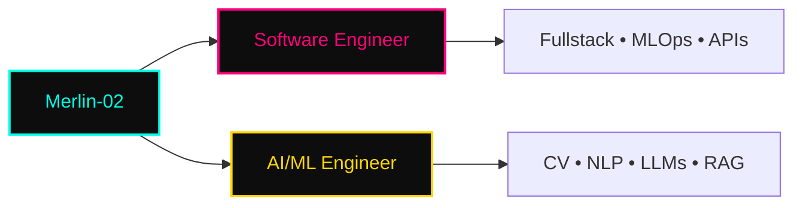
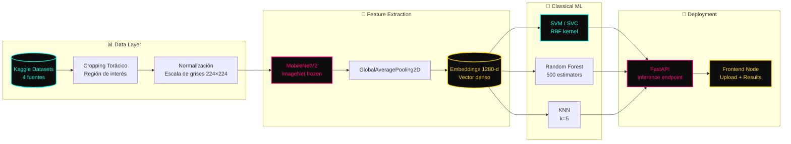
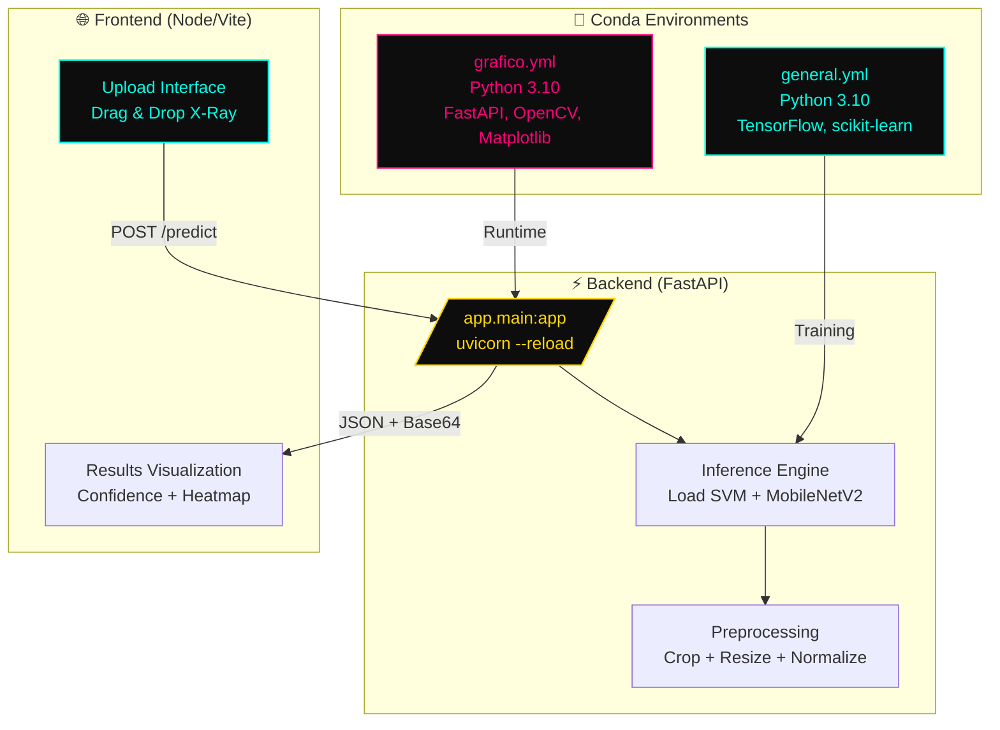
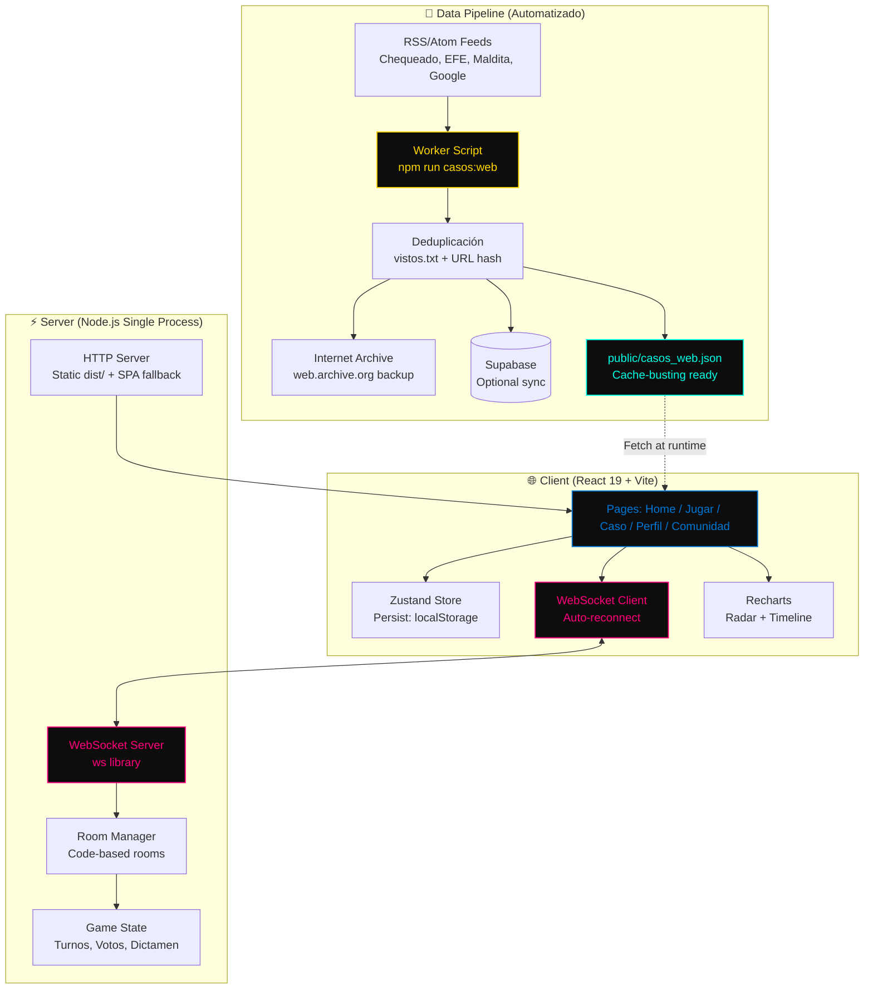
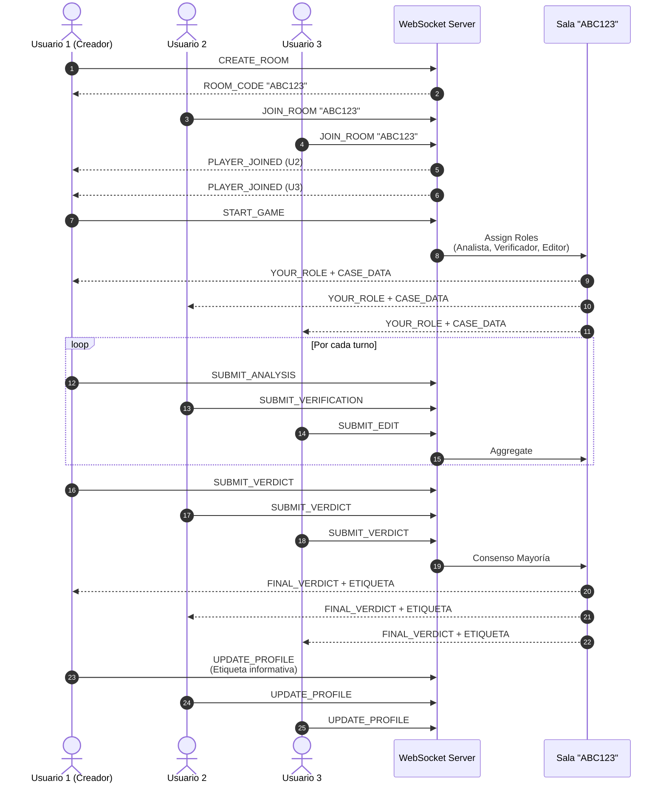

<p align="center">
  
</p>

<p align="center">
  
  
  
  
</p>

---

## `$ whoami`



---

## `$ cat tech-stack.yaml`

```yaml
magin-dev:~$ cat tech-stack.yaml
├─ 🐳 containers_ci_cd:
│   🐳 Docker · 🐳 Docker Compose · ⚡ GitHub Actions
├─ 🗄 databases:
│   🐘 PostgreSQL · 🍃 MongoDB · 🐬 MySQL
├─ 🐍 languages_frameworks:
│   🐍 Python · ⚡ FastAPI · 🤗 Hugging Face · 🔥 PyTorch · 🟠 TensorFlow
├─ 🧠 ai_ml_cv_nlp:
│   👁 OpenCV · 🎯 YOLO · 🧠 LLMs · 🔗 RAG · 📐 Embeddings · 🤖 LangChain
├─ ☁ cloud_tools:
│   📦 Git · 🐙 GitHub · 🐧 Linux · 🔧 Bash · 📝 Markdown
status: training · environment: production-ready
```

<div align="center">

### **Containers & CI/CD**
[](https://www.docker.com/) [](https://docs.docker.com/compose/) [](https://github.com/features/actions)

### **Databases**
[](https://www.postgresql.org/) [](https://www.mongodb.com/) [](https://www.mysql.com/)

### **Languages & Frameworks**
[](https://www.python.org/) [](https://fastapi.tiangolo.com/) [](https://pytorch.org/) [](https://www.tensorflow.org/) [](https://huggingface.co/)

### **AI / ML / Computer Vision / NLP**
[](https://opencv.org/) [](https://ultralytics.com/) [](https://www.langchain.com/) []() []() []()

### **Cloud & Tools**
[](https://git-scm.com/) [](https://github.com/) [](https://www.linux.org/) [](https://www.gnu.org/software/bash/) [](https://www.markdownguide.org/)

</div>

---

## `$ kubectl get signals --all-namespaces`

<div align="center">
  
  
</div>

<div align="center">
  
</div>

---

## `$ ls -la featured-projects/`

<div align="center">

| Proyecto | Descripción | Tech Stack | Estado |
|----------|-------------|------------|--------|
| 🔗 **[Pulmones_Metodologia](https://github.com/Merlin-02/Pulmones_Metodologia)** | Diagnóstico asistido COVID-19/Tuberculosis/Saludable con Transfer Learning (MobileNetV2) + SVM clásico — **97.68% accuracy** en 560 imágenes test | `Python` `TensorFlow` `MobileNetV2` `scikit-learn` `FastAPI` `Node.js` `Docker` `Conda` | 🟢 Active |
| 🔗 **[Detective_Digital (MediaMind)](https://github.com/Merlin-02/Detective_Digital)** | MVP Hackathon UNESCO 2026 — Juego de alfabetización mediática con "etiqueta informativa" nutricional, multijugador online, comunidad verificada, i18n ES/EN/PT | `React 19` `TypeScript` `Vite` `Tailwind v4` `Zustand` `Recharts` `Node.js` `WebSocket` `Railway` | 🟢 Active |
| 🔗 **[Repo 3](https://github.com/Merlin-02)** | Descripción breve del proyecto | `Python` `LangChain` `LLMs` `RAG` `PostgreSQL` | 🟡 WIP |
| 🔗 **[Repo 4](https://github.com/Merlin-02)** | Descripción breve del proyecto | `Python` `TensorFlow` `Embeddings` `GitHub Actions` | 🟢 Active |

> **Nota:** Edita la tabla arriba con tus 4-6 repos más representativos. Usa `git push` para actualizar.

</div>

---

## `$ cat project-details/`

<details>
<summary><b>🫁 <span style="color:#00FFE5">PULMONES_METODOLOGIA</span> — Computer Vision Médico + ML Clásico</b></summary>

<p align="center">
  <a href="https://github.com/Merlin-02/Pulmones_Metodologia">
    
    
    
    
    
    
  </a>
</p>

### 🛠 Tech Stack Visual
<p align="center">
  [](https://www.python.org/) [](https://www.tensorflow.org/) [](https://fastapi.tiangolo.com/) [](https://scikit-learn.org/) [](https://www.docker.com/) [](https://docs.conda.io/) [](https://nodejs.org/) [](https://github.com/features/actions)
</p>

### 🎯 Problema & Solución
Clasificación automática de **3 clases** (COVID-19, Tuberculosis, Saludable) en radiografías de tórax usando **MobileNetV2** como extractor de características (vectores densos 1280-d) + clasificadores clásicos.

### 📊 Resultados Clave
| Modelo | Accuracy | Precision | F1-Score | Destaca en |
|--------|----------|-----------|----------|------------|
| **SVM (SVC)** | **0.9768** | 0.98 | 0.98 | Generalización en alta dimensionalidad |
| Random Forest | 0.9750 | 0.97 | 0.97 | Robustez |
| KNN | 0.9411 | 0.94 | 0.94 | Baseline |

- **COVID-19:** Precision 0.95 / Recall 0.99
- **Tuberculosis:** Precision 0.99 / Recall 0.98 (F1: 0.99)

### 🔬 Metodología
1. **Dataset compilado** de 4 fuentes Kaggle + cropping focalizado región torácica → elimina ruido periférico
2. **Feature Extraction:** MobileNetV2 (ImageNet, frozen) + GlobalAveragePooling2D → vectores 1280-d
3. **Clasificación:** SVM/RF/KNN sobre embeddings (no fine-tuning → rápido, interpretable, poco data)

### 📐 Pipeline de Datos & Entrenamiento


### 🏗 Arquitectura Full-Stack


### 🚀 Quick Start
```bash
# Entornos Conda
conda env create -f general.yml      # Training + Feature Extraction
conda env create -f grafico.yml      # Backend + Visualización

# Backend (FastAPI)
cd backend && uvicorn app.main:app --reload

# Frontend
cd frontend && npm install && npm run dev
```

</details>

<details>
<summary><b>🕵️ <span style="color:#FF007A">DETECTIVE_DIGITAL (MEDIAMIND)</span> — MIL Gamificada UNESCO 2026</b></summary>

<p align="center">
  <a href="https://github.com/Merlin-02/Detective_Digital">
    
    
    
    
    
    
  </a>
</p>

### 🛠 Tech Stack Visual
<p align="center">
  [](https://react.dev/) [](https://www.typescriptlang.org/) [](https://vite.dev/) [](https://tailwindcss.com/) [](https://nodejs.org/) [](https://github.com/features/actions) [](https://railway.app/)
</p>

### 🎯 Problema & Solución
**Alfabetización Mediática e Informacional (MIL)** gamificada: convierte el consumo de información en hábito medible. Alineado a **5 Leyes UNESCO MIL** + **MIL CLICKS**.

### 🎮 Core Features
| Feature | Descripción |
|---------|-------------|
| 🕵️ **Juego Investigación** | Casos reales/sintéticos (deepfakes, voces IA, cadenas virales) → clasificar: Real/Manipulado/Falso/IA |
| 🍎 **Etiqueta Informativa** | "Nutricional" dinámica: Precisión, Diversidad, Balance, Nivel Investigador — se genera por decisión |
| 👥 **Mystery Media (Equipo)** | Roles complementarios + dictamen grupal |
| 🌐 **Multijugador Online** | Salas por código, turnos, votación sincronizada (WebSocket) |
| 🏘 **Comunidad Verificada** | Cursos, webinars, material real, casos co-creados con votación |
| 🔒 **Privacy by Design** | Datos en `localStorage`, borrables, usuario decide qué compartir |
| 🌍 **i18n** | ES / EN / PT |

### 🧠 Marco Pedagógico (UNESCO MIL CLICKS)
- **Ley 1:** Acceso crítico → Etiqueta hace visible el consumo
- **Ley 2:** Creación → Comunidad verificada co-crea casos
- **Ley 3:** Evaluación → Contraste fuentes + señales manipulación
- **Ley 4:** Derecho a saber → Juego en entorno real (memes, virales)
- **Ley 5:** Proceso vivo → Hábitos se entrenan donde circula desinfo

### ⚡ Tech Stack Moderno
```
Frontend:     React 19 + TypeScript + Vite + Tailwind CSS v4 (UNESCO Blue #0077D4)
State:        Zustand (persistencia local = "mock backend")
Charts:       Recharts (radar + evolución precisión)
Realtime:     Node.js + ws (WebSocket) — mismo puerto que HTTP
Data Pipeline: RSS/Atom feeds (Chequeado, EFE Verifica, Maldita.es, Google News)
  → Deduplicación + Internet Archive backup + Supabase sync (opcional)
Deploy:       Railway (single service: static + WS)
```

### 🏗 Arquitectura del Sistema


### 🔄 Flujo de Juego Multijugador (Mystery Media)


### 🗂 Rutas Principales
| Ruta | Contenido |
|------|-----------|
| `/` | Home: ciclo juego → etiqueta → recomendaciones |
| `/jugar` | Selección modo (individual/equipo) + casos |
| `/caso/:id` | Caso individual o Mystery Media |
| `/multijugador` | Salas online por código |
| `/perfil` | Etiqueta informativa, radar, recomendaciones |
| `/comunidad` | Comunidad educativa verificada |

### 🚀 Quick Start
```bash
npm install
npm run dev              # Vite dev server
npm run server           # WebSocket server (ws://localhost:8787)
npm run casos:web        # Descarga feeds verificadores → public/casos_web.json

# Build + Deploy (Railway)
npm run build && npm run start
```

### 📡 Banco de Casos Web (Automatizado)
```bash
npm run casos:web -- --max 12
# Fuentes: Chequeado, EFE Verifica, Maldita.es, Google Noticias (verificación)
# Salidas: public/casos_web.json + server/db/casos.db.json + server/db/vistos.txt
# Cada caso: enlace fuente original + copia Internet Archive
```

</details>

---

## `$ connect --socials`

<p align="center">
  <a href="https://github.com/Merlin-02" target="_blank">
    
  </a>
  <a href="https://www.instagram.com/merli_nx19" target="_blank">
    
  </a>
  <a href="mailto:cabreracoyotzikevinmerlin@gmail.com" target="_blank">
    
  </a>
  <a href="https://linkedin.com/in/TU_USUARIO" target="_blank">
    
  </a>
</p>

---

<p align="center">
  
</p>

<p align="center">
  <sub>Built with <span style="color:#FF007A">❤</span> + <span style="color:#00FFE5">caffeine</span> · <span style="color:#FFD700">Merlin-02</span> · <a href="https://github.com/Merlin-02/Merlin-02" style="color:#00FFE5">View Source</a></sub>
</p>

---

<details>
<summary><b>🔧 <span style="color:#00FFE5">CONFIG & CUSTOMIZATION</span></b></summary>

### Badges usados
- **skillicons.dev** — Iconos consistentes para tech stack principal
- **shields.io** — Badges custom para IA/ML (PyTorch, TensorFlow, YOLO, Hugging Face, LangChain, RAG, Embeddings)
- **readme-typing-svg** — Animaciones de typing en banner y footer
- **github-readme-stats** — Stats cards + top langs + streak

### Para personalizar tu perfil:
1. Crea repo **`Merlin-02/Merlin-02`** (público)
2. Sube este `README.md` a la rama `main`
3. Edita la tabla **`$ ls -la featured-projects/`** con tus repos reales
4. Agrega tu **LinkedIn URL** en `$ connect --socials`
5. (Opcional) Agrega WakaTime: `[](https://wakatime.com/@Merlin-02)`

### Colores Cyberpunk/Neon usados:
- **Cyan Neon**: `#00FFE5` (primary)
- **Magenta Neon**: `#FF007A` (accent)
- **Gold Neon**: `#FFD700` (highlight)
- **Dark BG**: `#0D0D0D` (terminal background)

### 🤖 CI/CD Templates (Listos para copiar)
Plantillas de GitHub Actions incluidas en este repo para que las copies a tus proyectos:

| Proyecto | Template | Qué valida |
|----------|----------|------------|
| **Pulmones_Metodologia** | `workflow-templates/pulmones/ci.yml` | Conda envs (general.yml, grafico.yml), imports TF/sklearn/FastAPI, frontend build, Docker build |
| **Detective_Digital** | `workflow-templates/detective/ci.yml` | TypeScript typecheck, oxlint, Vite build, WebSocket server test, Railway preview deploy |

**Uso:**
```bash
# En cada repo destino:
mkdir -p .github/workflows
cp /ruta/a/workflow-templates/pulmones/ci.yml .github/workflows/ci.yml
# O para Detective:
cp /ruta/a/workflow-templates/detective/ci.yml .github/workflows/ci.yml

# Agrega secrets en GitHub Settings > Secrets:
# RAILWAY_TOKEN (para Detective preview deploy)
```

### 📁 Estructura de Assets
```
Merlin-02/
├── README.md
├── assets/
│   └── banner.svg           # Banner cyberpunk animado (SVG + CSS)
├── .github/
│   └── workflows/
│       └── validate.yml     # Validación del perfil (markdown, links, mermaid, assets)
├── .markdownlint.json       # Config markdownlint
└── workflow-templates/
    ├── pulmones/ci.yml      # Template CI para Pulmones
    └── detective/ci.yml     # Template CI para Detective
```

</details>