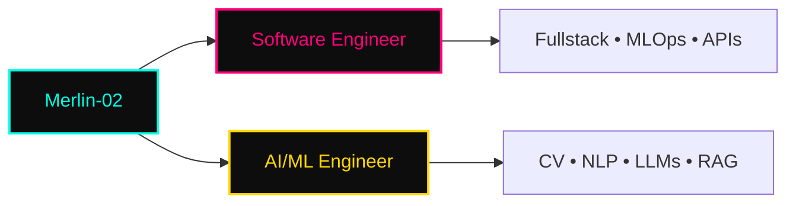

<p align="center">
  
</p>

<p align="center">
  
  
  
</p>

---

## `$ whoami`



---

## `$ cat tech-stack.yaml`

```yaml
magin-dev:~$ cat tech-stack.yaml
├─ 🐳 containers_ci_cd:
│   🐳 Docker · 🐳 Docker Compose · ⚡ GitHub Actions
├─ 🗄 databases:
│   🐘 PostgreSQL · 🍃 MongoDB · 🐬 MySQL
├─ 🐍 languages_frameworks:
│   🐍 Python · ⚡ FastAPI · 🤗 Hugging Face · 🔥 PyTorch · 🟠 TensorFlow
├─ 🧠 ai_ml_cv_nlp:
│   👁 OpenCV · 🎯 YOLO · 🧠 LLMs · 🔗 RAG · 📐 Embeddings · 🤖 LangChain
├─ ☁ cloud_tools:
│   📦 Git · 🐙 GitHub · 🐧 Linux · 🔧 Bash · 📝 Markdown
status: training · environment: production-ready
```

<div align="center">

### **Containers & CI/CD**
[](https://www.docker.com/) [](https://docs.docker.com/compose/) [](https://github.com/features/actions)

### **Databases**
[](https://www.postgresql.org/) [](https://www.mongodb.com/) [](https://www.mysql.com/)

### **Languages & Frameworks**
[](https://www.python.org/) [](https://fastapi.tiangolo.com/) [](https://pytorch.org/) [](https://www.tensorflow.org/) [](https://huggingface.co/)

### **AI / ML / Computer Vision / NLP**
[](https://opencv.org/) [](https://ultralytics.com/) [](https://www.langchain.com/) []() []() []()

### **Cloud & Tools**
[](https://git-scm.com/) [](https://github.com/) [](https://www.linux.org/) [](https://www.gnu.org/software/bash/) [](https://www.markdownguide.org/)

</div>

---

## `$ kubectl get signals --all-namespaces`

<div align="center">
  
  
</div>

<div align="center">
  
</div>

---

## `$ ls -la featured-projects/`

<div align="center">

| Proyecto | Descripción | Tech Stack | Estado |
|----------|-------------|------------|--------|
| 🔗 **[Repo 1](https://github.com/Merlin-02)** | Descripción breve del proyecto | `Python` `FastAPI` `PyTorch` `Docker` | 🟢 Active |
| 🔗 **[Repo 2](https://github.com/Merlin-02)** | Descripción breve del proyecto | `Python` `OpenCV` `YOLO` `MongoDB` | 🟢 Active |
| 🔗 **[Repo 3](https://github.com/Merlin-02)** | Descripción breve del proyecto | `Python` `LangChain` `LLMs` `RAG` `PostgreSQL` | 🟡 WIP |
| 🔗 **[Repo 4](https://github.com/Merlin-02)** | Descripción breve del proyecto | `Python` `TensorFlow` `Embeddings` `GitHub Actions` | 🟢 Active |

> **Nota:** Edita la tabla arriba con tus 4-6 repos más representativos. Usa `git push` para actualizar.

</div>

---

## `$ connect --socials`

<p align="center">
  <a href="https://github.com/Merlin-02" target="_blank">
    
  </a>
  <a href="https://www.instagram.com/merli_nx19" target="_blank">
    
  </a>
  <a href="mailto:cabreracoyotzikevinmerlin@gmail.com" target="_blank">
    
  </a>
  <a href="https://linkedin.com/in/TU_USUARIO" target="_blank">
    
  </a>
</p>

---

<p align="center">
  
</p>

<p align="center">
  <sub>Built with <span style="color:#FF007A">❤</span> + <span style="color:#00FFE5">caffeine</span> · <span style="color:#FFD700">Merlin-02</span> · <a href="https://github.com/Merlin-02/Merlin-02" style="color:#00FFE5">View Source</a></sub>
</p>

---

<details>
<summary><b>🔧 <span style="color:#00FFE5">CONFIG & CUSTOMIZATION</span></b></summary>

### Badges usados
- **skillicons.dev** — Iconos consistentes para tech stack principal
- **shields.io** — Badges custom para IA/ML (PyTorch, TensorFlow, YOLO, Hugging Face, LangChain, RAG, Embeddings)
- **readme-typing-svg** — Animaciones de typing en banner y footer
- **github-readme-stats** — Stats cards + top langs + streak

### Para personalizar tu perfil:
1. Crea repo **`Merlin-02/Merlin-02`** (público)
2. Sube este `README.md` a la rama `main`
3. Edita la tabla **`$ ls -la featured-projects/`** con tus repos reales
4. Agrega tu **LinkedIn URL** en `$ connect --socials`
5. (Opcional) Agrega WakaTime: `[](https://wakatime.com/@Merlin-02)`

### Colores Cyberpunk/Neon usados:
- **Cyan Neon**: `#00FFE5` (primary)
- **Magenta Neon**: `#FF007A` (accent)
- **Gold Neon**: `#FFD700` (highlight)
- **Dark BG**: `#0D0D0D` (terminal background)

</details>